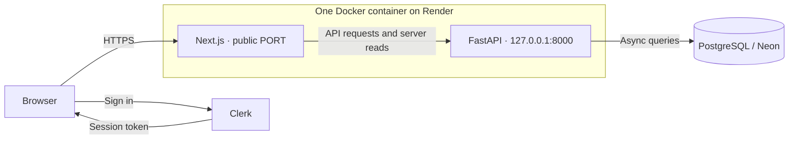
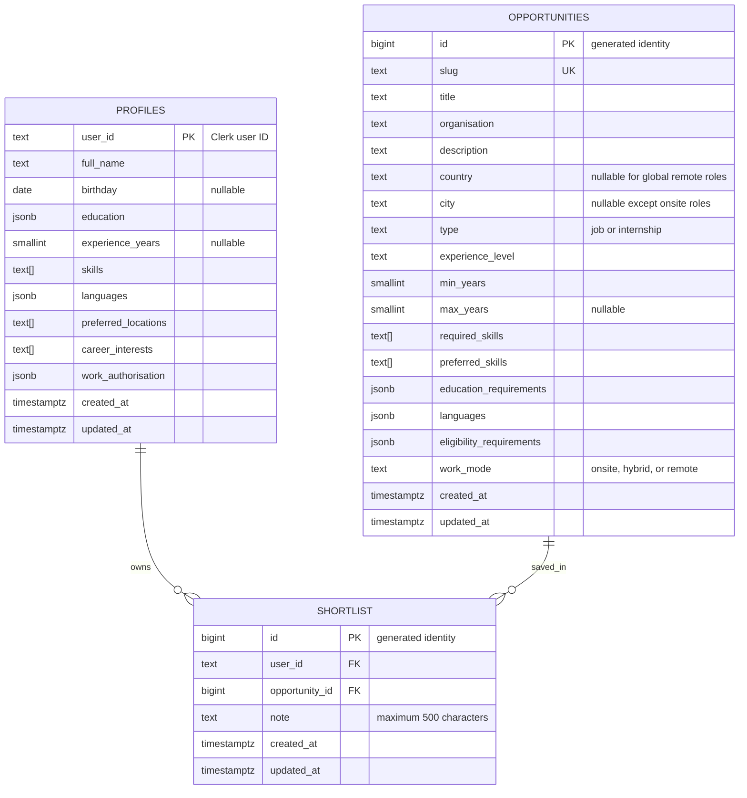

<div align="center">

<h1>Career Mobility 🚀🌍</h1>

<h3>Career Assessment &amp; Opportunity Matching Platform</h3>

<p>Understand your strengths, explore opportunities, and plan your next career move with explainable recommendations.</p>

<p>
  <a href="https://react.dev"></a>
  <a href="https://nextjs.org"></a>
  <a href="https://fastapi.tiangolo.com"></a>
  <a href="https://www.postgresql.org"></a>
  <a href="https://clerk.com"></a>
  <a href="https://www.docker.com"></a>
  <a href="https://render.com"></a>
</p>

<p>
  <a href="#about-the-project">About</a> ·
  <a href="#tech-stack">Tech Stack</a> ·
  <a href="#database-schema">Database Schema</a> ·
  <a href="#deploy-to-render">Deploy</a> ·
  <a href="#local-development">Run Locally</a>
</p>

</div>

---

## About the Project

**Career Mobility** helps people compare their background with job and internship
requirements. Users build a profile, browse opportunities, review ranked matches,
and keep a personal shortlist with notes.

Rather than presenting an unexplained score, the platform shows how **skills,
languages, experience, education, and location preferences** contribute to each
recommendation. Eligibility concerns are shown separately so a good skills match
is not mistaken for confirmed work authorisation or hiring eligibility.

Matching uses deterministic backend rules—not an AI model. Missing information
stays unknown instead of being filled with invented answers. The included catalog
contains twelve fictional opportunities for demonstration.

### Features

- **In-app authentication:** Clerk sign-in, registration, and account management.
- **Career profiles:** Education, experience, skills, languages, preferences, and work authorisation.
- **Opportunity discovery:** Search and filter jobs and internships by country, type, and work mode.
- **Explainable matching:** Ranked recommendations with criterion scores, reasons, and eligibility flags.
- **Private shortlists:** Save opportunities and maintain personal notes.
- **Dashboard:** Profile overview, opportunity totals, saved items, and top matches.
- **Data control:** Delete application-owned profile and shortlist data without deleting the Clerk identity.

## Tech Stack

| Layer | Technologies | Purpose |
| --- | --- | --- |
| Frontend | Next.js 16, React 19, TypeScript | App Router pages and component-based interface |
| Styling | Tailwind CSS 4, Flowbite React | Responsive layouts, forms, navigation, and shared UI |
| Authentication | Clerk | User identities, sign-in flows, and signed session tokens |
| Backend | Python 3.13, FastAPI, Uvicorn | REST API, authorisation, matching, and business logic |
| Validation | Zod, Pydantic | Frontend contracts and backend request/response validation |
| Database | PostgreSQL, Neon | Persistent profiles, opportunities, and shortlist data |
| Data access | SQLAlchemy, asyncpg | Async database queries and transactions |
| Migrations | Alembic | Versioned database schema changes |
| Token verification | PyJWT, cryptography | Verify Clerk session signatures, issuer, expiry, and allowed origins |
| Tooling | npm, uv, Biome, Ruff | Locked dependencies and code quality tooling |
| Deployment | Docker, Render, Tini | One container running both application servers |

The frontend and backend remain separate projects in the repository, but production
deployment uses **one root Dockerfile and one Render Web Service**.

## Architecture



- Next.js serves the interface and forwards `/api/v1/*` requests to FastAPI.
- FastAPI owns API authentication, resource ownership, persistence, scoring, ranking, and totals.
- Browser API calls use the same public HTTPS origin as the frontend.
- Server-side reads reach FastAPI through the container's private loopback address.
- Clerk owns identities; PostgreSQL stores application data, not passwords.
- Tini and the Dockerfile's embedded launcher manage startup and shutdown of both servers.

## Database Schema

The database has three application tables: **profiles**, **opportunities**, and
**shortlist**. A Clerk user ID identifies the owner of a profile; there is no local
`users` table or password store.



### Model Responsibilities

| Model | Stores |
| --- | --- |
| `profiles` | One user's career background, preferences, and declared work authorisation |
| `opportunities` | Role descriptions, location details, skills, and structured requirements |
| `shortlist` | A user's saved opportunity and optional personal note |

**Relationships and constraints:**

- Each Clerk user can have one profile, keyed by `user_id`.
- Each profile can have many shortlist entries; each opportunity can be saved by many users.
- `(user_id, opportunity_id)` is unique, preventing duplicate saves.
- Shortlist foreign keys cascade when the associated profile or opportunity is deleted.
- Opportunity slugs are unique; generated numeric IDs identify opportunities and shortlist entries.
- Experience ranges, supported role/work-mode values, note length, and collection sizes are validated.
- Structured education, language, and eligibility data use `JSONB`; string collections use PostgreSQL arrays.
- All three tables track timezone-aware creation and update timestamps.

Match results are **computed on demand**, not stored in another table. The matcher
combines known criterion scores and returns a label such as strong, partial, weak,
not recommended, or insufficient data. Unknown criteria do not become automatic
failures; critical eligibility flags can mark a role as not recommended independently
of its numeric score.

## Project Structure

```text
.
├── Dockerfile                 # Both apps in one production container
├── .dockerignore              # Excludes local secrets and generated files
├── Frontend/
│   ├── app/                   # Next.js routes and layouts
│   ├── components/            # Screens and reusable UI
│   ├── hooks/                 # Client workflow hooks
│   ├── lib/                   # Contracts, API transport, forms, and display helpers
│   └── package-lock.json      # Locked JavaScript dependencies
└── Backend/
    ├── app/
    │   ├── api/               # Health and versioned REST endpoints
    │   ├── core/              # Configuration, authentication, and errors
    │   ├── db/                # Models, repositories, and seed command
    │   ├── schemas/           # Pydantic API contracts
    │   └── services/          # Business logic and matching engine
    ├── alembic/               # Database migrations
    └── uv.lock                # Locked Python dependencies
```

## Deploy to Render

### 1. Prepare Authentication and Database

Use a Clerk instance and a PostgreSQL database, such as Neon. Obtain the Clerk
publishable key, server secret key, and **PEM public signing key** from the same
instance. Configure Clerk for your deployed application domain.

PostgreSQL is hosted separately; the application Dockerfile does not run a database
server or store database files inside the container.

### 2. Create One Docker Web Service

In Render, choose **New → Web Service**, connect this repository, and use:

| Setting | Value |
| --- | --- |
| Branch | `main` |
| Language / Runtime | `Docker` |
| Root Directory | Leave empty |
| Dockerfile Path | `./Dockerfile` |
| Docker Build Context | `.` |
| Docker Command | Leave empty |
| Health Check Path | `/health` |

**Only one Render Web Service is needed.** Next.js listens on Render's public
`PORT` (default `10000`); FastAPI listens privately on `127.0.0.1:8000` in the same
container. No Docker Compose or second application service is required. Both apps
share the instance's CPU and memory.

### 3. Add Render Environment Variables

Set these in the service's **Environment** settings. Do not upload or commit `.env`
files. In the examples below, replace `career-mobility.onrender.com` with your
actual service hostname.

| Variable | Value / purpose |
| --- | --- |
| `NEXT_PUBLIC_API_URL` | This **same service's** HTTPS origin, e.g. `https://career-mobility.onrender.com`, without `/api/v1` or another path |
| `NEXT_PUBLIC_CLERK_PUBLISHABLE_KEY` | Clerk publishable key |
| `CLERK_SECRET_KEY` | Clerk server secret; runtime only |
| `ENV` | `production` |
| `AUTH_MODE` | `clerk` |
| `JWKS_PUBLIC_KEY` | Clerk's PEM public signing key, not a JWKS URL or JSON document; actual or escaped newlines are supported |
| `CORS_ORIGINS` | JSON array of public frontend origins, e.g. `["https://career-mobility.onrender.com"]` |
| `CLERK_AUTHORIZED_PARTIES` | The same exact public-origin JSON array |
| `DATABASE_URL` | PostgreSQL connection URL; use the direct URL when paired with `DATABASE_URL_POOLED` |
| `DATABASE_URL_POOLED` | Optional pooled PostgreSQL URL for application connections |
| `DIRECT_URL` | Optional explicit direct database URL for migrations |

Both origin lists must name the **public application URL**, not the private backend
address. Update them when adding a custom domain. Use keys from the same Clerk
instance, and never place database credentials or the Clerk secret in a
`NEXT_PUBLIC_*` variable.

Render also makes environment settings available as Docker build arguments. The
Dockerfile consumes **only** `NEXT_PUBLIC_API_URL` and
`NEXT_PUBLIC_CLERK_PUBLISHABLE_KEY` during the frontend build. Set both before the
first build; changing either later requires a **rebuild**, not just a restart.
Server secrets are runtime-only and are not baked into image layers.

`PORT`, `PANAMA_SINGLE_CONTAINER`, and `API_INTERNAL_URL` are handled by the image
or Render. Do not replace the image's internal routing configuration.

### 4. Deploy and Initialise a New Database

Save the environment settings and trigger a build/deploy. The container does not
automatically migrate or seed the database. Once the service is running, initialise
a new, intended target database from Render's shell:

```sh
cd /app/Backend
alembic upgrade head
```

Migrations require a direct connection: set `DIRECT_URL`, or supply the paired
direct `DATABASE_URL` and pooled `DATABASE_URL_POOLED`. Where your Render plan
supports it, the equivalent Pre-Deploy Command is
`cd /app/Backend && alembic upgrade head`.

**Optional demo catalog:** from the same backend directory, explicitly load the
twelve fictional opportunities:

```sh
python -m app.db.seed --apply
```

This command upserts catalog rows by slug and does not create user profiles.
Migration and seed commands change the configured database; run them only after
confirming the intended target. Neither is required on every container restart.

### 5. Open the Application

After deployment and database initialisation, open the service's public URL to
sign in, create a profile, explore opportunities, and view matches.

- `/health` reaches FastAPI through Next.js, checking that both servers can respond.
- `/api/health` checks Next.js alone.
- Health responses do not verify database connectivity or Clerk authentication.

The latest container setup has not been build/runtime-verified in this workspace;
do not treat a configured Dockerfile or green liveness endpoint as proof that all
authentication and persistence workflows have been validated.

## Local Development

**Requirements:** Node.js **24.22.3**, npm **11.20.0**, and uv with Python **3.13.18**.

Keep local configuration in the repository-root `.env`, or use project-local
environment files. Process environment values take precedence over project-local
values, which take precedence over root values. Environment files remain excluded
from Git and Docker builds.

For local development, use `http://127.0.0.1:8000` as `NEXT_PUBLIC_API_URL`. Allow
your browser's frontend origin in both backend origin lists; `localhost` and
`127.0.0.1` are different origins.

**Frontend terminal:**

```sh
cd Frontend
npm ci
npm run dev
```

**Backend terminal:**

```sh
cd Backend
uv sync --locked --managed-python
uv run --locked --managed-python uvicorn app.main:create_app --factory --host 127.0.0.1 --port 8000 --reload
```

Open `http://localhost:3000`. Apply migrations to an intended local/development
database before using persistence-dependent workflows.

See [Frontend/README.md](Frontend/README.md) and [Backend/README.md](Backend/README.md)
for project-specific configuration and verification details.

---

**Prototype scope:** Recommendations support exploration, not hiring decisions or
legal advice. Catalog examples are fictional, and work authorisation or other
eligibility requirements still need independent confirmation.
